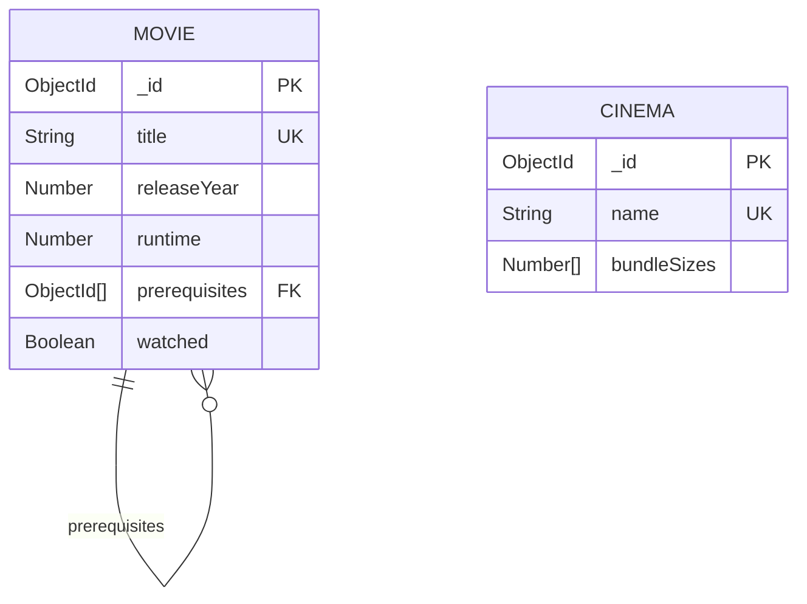

# Doomsday Ready

A MERN stack application that helps MCU fans plan their movie rewatch order before Avengers: Doomsday and calculate opening-night cinema group bookings.

## Features

### 1. Movies

- Add movies with unique titles, release years, and runtimes.
- Add or edit movie prerequisites.
- Mark movies as watched or unwatched.
- Prevent circular movie dependencies.

### 2. Rewatch Plan

- Generate the prerequisite watch order for a selected movie.
- Display each prerequisite exactly once.
- Show watched movie count.
- Track watching progress with a progress bar.
- Calculate remaining unwatched runtime.

### 3. Cinema Booking

- Add cinemas with unique names.
- Configure available seat bundle sizes.
- Calculate the minimum number of bundles required for a group.
- Show the quantity of each bundle size.
- Handle impossible booking combinations.

## Technology Stack

**Frontend**

- React
- Vite
- Tailwind CSS
- React Router

**Backend**

- Node.js
- Express.js
- MongoDB
- Mongoose

## Project Structure

```text
doomsday-ready/
├── backend/
│   ├── src/
│   │   ├── config/
│   │   ├── controllers/
│   │   ├── middleware/
│   │   ├── models/
│   │   ├── routes/
│   │   ├── services/
│   │   ├── utils/
│   │   ├── app.js
│   │   └── server.js
│   └── test/
├── frontend/
│   └── src/
│       ├── components/
│       ├── context/
│       ├── hooks/
│       ├── layouts/
│       ├── pages/
│       ├── services/
│       ├── utils/
│       ├── App.jsx
│       └── main.jsx
├── .gitignore
└── README.md
```

## Data Model



## Algorithms

### Movie Rewatch Order

A graph-based approach is used to traverse prerequisite relationships.

- Depth-first search is used to visit prerequisite movies.
- A visited set prevents duplicate movies.
- The resulting order places prerequisites before dependent movies.
- Circular dependencies are rejected with HTTP 409.

### Cinema Booking

A bottom-up Dynamic Programming approach calculates the minimum number of bundles.

- Each possible group size is evaluated.
- The minimum bundle count is stored for each total.
- Selected bundle sizes are tracked to reconstruct the final combination.
- If no exact combination exists, the result is marked as impossible.

No external library is used to solve these two core algorithmic problems.

## Installation and Setup

### Prerequisites

- Node.js
- npm
- MongoDB database

### 1. Clone the repository

```bash
git clone https://github.com/mamun007molla/doomsday-ready.git
cd doomsday-ready
```

### 2. Backend Setup

```bash
cd backend
npm install
```

Create a `.env` file inside the backend folder:

```env
PORT=5000
MONGODB_URI=your_mongodb_connection_string
```

Start the backend:

```bash
npm run dev
```

### 3. Frontend Setup

Open another terminal:

```bash
cd frontend
npm install
```

Create a `.env` file inside the frontend folder:

```env
VITE_API_URL=http://localhost:5000/api
```

Start the frontend:

```bash
npm run dev
```

Open the local URL displayed by Vite in your browser.

## API Endpoints

| Method | Endpoint                               | Purpose                |
| ------ | -------------------------------------- | ---------------------- |
| POST   | `/api/movies`                          | Create a movie         |
| GET    | `/api/movies`                          | Get all movies         |
| PATCH  | `/api/movies/:id`                      | Update a movie         |
| GET    | `/api/movies/:id/rewatch-order`        | Generate rewatch order |
| POST   | `/api/cinemas`                         | Create a cinema        |
| GET    | `/api/cinemas`                         | Get all cinemas        |
| GET    | `/api/cinemas/:id/booking?groupSize=6` | Calculate booking      |

## Running Tests

From the backend directory:

```bash
npm test
```

## AI Usage Disclosure

AI tools were used as learning and development assistants during this project.

They helped with:

- Understanding the assessment requirements.
- Planning the project structure.
- Explaining MERN stack concepts and implementation steps.
- Reviewing code and debugging errors.
- Suggesting test cases and documentation improvements.

The project was developed step by step while reviewing, implementing, and testing the code. The core graph traversal and dynamic programming logic were implemented and tested as part of the project work.

## Author

Mamun Molla

GitHub: https://github.com/mamun007molla
