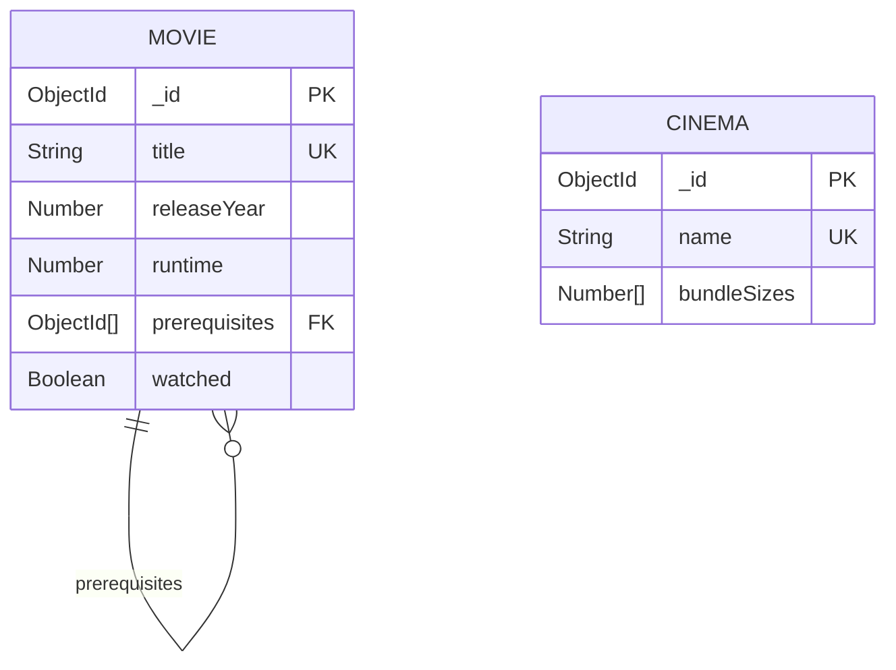

# Doomsday Ready

A MERN stack application that helps MCU fans plan their movie rewatch order before Avengers: Doomsday and calculate opening-night cinema group bookings.

## Features

### 1. Movies

- Add movies with unique titles, release years, and runtimes.
- Add or edit movie prerequisites.
- Mark movies as watched or unwatched.
- Prevent circular movie dependencies.

### 2. Rewatch Plan

- Generate the prerequisite watch order for a selected movie.
- Display each prerequisite exactly once.
- Show watched movie count.
- Track watching progress with a progress bar.
- Calculate remaining unwatched runtime.

### 3. Cinema Booking

- Add cinemas with unique names.
- Configure available seat bundle sizes.
- Calculate the minimum number of bundles required for a group.
- Show the quantity of each bundle size.
- Handle impossible booking combinations.

## Technology Stack

**Frontend**

- React
- Vite
- Tailwind CSS
- React Router

**Backend**

- Node.js
- Express.js
- MongoDB
- Mongoose

## Project Structure

```text
doomsday-ready/
├── backend/
│   ├── src/
│   │   ├── config/
│   │   ├── controllers/
│   │   ├── middleware/
│   │   ├── models/
│   │   ├── routes/
│   │   ├── services/
│   │   ├── utils/
│   │   ├── app.js
│   │   └── server.js
│   └── test/
├── frontend/
│   └── src/
│       ├── components/
│       ├── context/
│       ├── hooks/
│       ├── layouts/
│       ├── pages/
│       ├── services/
│       ├── utils/
│       ├── App.jsx
│       └── main.jsx
├── .gitignore
└── README.md
```

## Data Model



## Algorithms

### Movie Rewatch Order

A graph-based approach is used to traverse prerequisite relationships.

- Depth-first search is used to visit prerequisite movies.
- A visited set prevents duplicate movies.
- The resulting order places prerequisites before dependent movies.
- Circular dependencies are rejected with HTTP 409.

### Cinema Booking

A bottom-up Dynamic Programming approach calculates the minimum number of bundles.

- Each possible group size is evaluated.
- The minimum bundle count is stored for each total.
- Selected bundle sizes are tracked to reconstruct the final combination.
- If no exact combination exists, the result is marked as impossible.

No external library is used to solve these two core algorithmic problems.

## Installation and Setup

### Prerequisites

- Node.js
- npm
- MongoDB database

### 1. Clone the repository

```bash
git clone https://github.com/mamun007molla/doomsday-ready.git
cd doomsday-ready
```

### 2. Backend Setup

```bash
cd backend
npm install
```

Create a `.env` file inside the backend folder:

```env
PORT=5000
DB_URI=your_mongodb_connection_string
```

Start the backend:

```bash
npm run dev
```

### 3. Frontend Setup

Open another terminal:

```bash
cd frontend
npm install
```

Create a `.env` file inside the frontend folder:

```env
VITE_API_URL=http://localhost:5000/api
```

Start the frontend:

```bash
npm run dev
```

Open the local URL displayed by Vite in your browser.

## API Endpoints

| Method | Endpoint                               | Purpose                |
| ------ | -------------------------------------- | ---------------------- |
| POST   | `/api/movies`                          | Create a movie         |
| GET    | `/api/movies`                          | Get all movies         |
| PATCH  | `/api/movies/:id`                      | Update a movie         |
| GET    | `/api/movies/:id/rewatch-order`        | Generate rewatch order |
| POST   | `/api/cinemas`                         | Create a cinema        |
| GET    | `/api/cinemas`                         | Get all cinemas        |
| GET    | `/api/cinemas/:id/booking?groupSize=6` | Calculate booking      |

## Running Tests

From the backend directory:

```bash
npm test
```

## AI Usage Disclosure

I used ChatGPT as an AI-assisted development and learning tool during this project. My approach was to work step by step rather than asking AI to generate the entire application in a single prompt.

### How I Used AI

- **Requirement Analysis and Planning:** I provided the assessment requirements and instructed ChatGPT to break the project into smaller development tasks so I could complete and understand them progressively.

- **Project Structure:** I chose the MERN stack and used AI guidance to organize the folder structure and follow an MVC-based backend architecture.

- **Backend Development:** I worked through the backend implementation step by step, using AI explanations and suggestions to understand database models, API routes, controllers, services, validation, and error handling.

- **Graph Algorithm:** I received AI assistance to understand graph concepts, Depth-First Search (DFS), visited sets, cycle detection, and prerequisite ordering for the movie rewatch feature.

- **Dynamic Programming:** I used AI guidance to understand the minimum-bundle booking problem, the bottom-up Dynamic Programming approach, and how to reconstruct the selected bundle combination.

- **Frontend Development:** I used AI assistance to implement portions of the React frontend, including the Movies, Rewatch Plan, and Booking views, and to connect these views with the backend APIs.

- **Debugging and Testing:** I ran the application, tested API endpoints, checked expected results, shared errors when needed, and used AI suggestions to troubleshoot and improve the implementation.

- **Documentation:** I used AI assistance to organize the README, document the project structure, and prepare setup instructions.

### My Involvement

I selected the technology stack, provided instructions for each development stage, configured the project environment and database, followed the implementation process, ran the application, tested the APIs and features, reviewed the results, and made development decisions throughout the project.

I used AI as a supporting tool for explanations, implementation assistance, debugging, and problem-solving. Some portions of the implementation, including frontend code and algorithm-related code, were generated or suggested with AI assistance. I reviewed and tested the resulting functionality during development.

My goal was not only to complete the assessment but also to understand the technologies, architecture, and problem-solving approaches used in the application.

## Docker Compose

### Prerequisites

- Docker
- Docker Compose

### Run the Project

Clone the repository and open the project root directory.

Start all services with:

```bash
docker compose up --build
```

The services will be available at:

- Frontend: http://localhost:5173
- Backend API: http://localhost:5000
- API Health Check: http://localhost:5000/api/health
- MongoDB: localhost:27017

### Stop the Project

Press `Ctrl + C`, then run:

```bash
docker compose down
```

MongoDB data is stored in a Docker volume named `mongo-data`.

## Author

Mamun Molla

GitHub: https://github.com/mamun007molla
